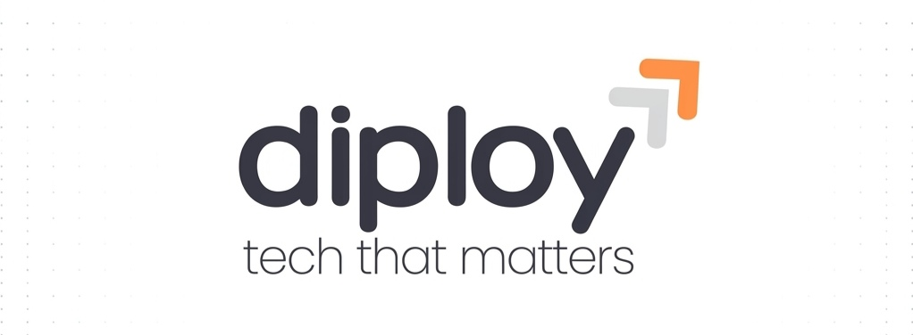

<!-- GitHub Organization Profile README -->

  <!-- Company Logo (Working Public URL) -->
    <h1 style="font-size: 2.5rem; margin-top: 10px;">🚀 Diploy Space</h1>
  
Building Digital Experiences. Engineering the Future.
  <!-- Professional Badges -->  

    
    
    
  
  

🌟 About Diploy Space

Welcome to Diploy Space, a technology and software development company focused on building innovative digital products, scalable applications, and modern software solutions. We transform complex ideas into reliable, scalable, and user-friendly digital experiences that move businesses forward.

---

💻 Our Expertise

<table width="100%" cellpadding="10" style="border-collapse: collapse;">
  <tr>
    <td width="50%" valign="top" style="border: 1px solid #e1e4e8; border-radius: 6px; padding: 15px;">
      <h4 style="margin-top: 0; color: #0366d6;">📱 Mobile & Web Engineering</h4>
      <ul>
        <li><b>Mobile Application Development</b> - High-performance native & cross-platform apps.</li>
        <li><b>Web Application Development</b> - Responsive, fast, and interactive web portals.</li>
        <li><b>Backend & API Engineering</b> - Robust and secure server-side architectures.</li>
        <li><b>E-commerce Solutions</b> - Modern, seamless, and high-converting online stores.</li>
      </ul>
    </td>
    <td width="50%" valign="top" style="border: 1px solid #e1e4e8; border-radius: 6px; padding: 15px;">
      <h4 style="margin-top: 0; color: #0366d6;">⚡ Architecture & Design</h4>
      <ul>
        <li><b>UI/UX Design</b> - User-centric, beautiful, and intuitive interfaces.</li>
        <li><b>Real-Time Applications</b> - Instant data sync, chat systems, and live tracking.</li>
        <li><b>Cloud & Infrastructure</b> - Reliable deployment, VPS tuning, and server management.</li>
        <li><b>Optimization</b> - Fine-tuning codebases for absolute peak performance.</li>
      </ul>
    </td>
  </tr>
</table>---

🛠️ Technology Stack

We leverage modern and trusted tools to engineer sustainable and highly efficient tech ecosystems:

Category| Technologies We Use
Mobile|  
Backend|   
Frontend|    
Database|  
Infrastructure|  
Design & Tools|    

---

👨‍💻 Development Teams

Our organization is divided into specialized agile units ensuring focus on every layer:

* Flutter Development Team — Crafting beautiful and immersive multi-platform frontend solutions.
* Laravel & Node Backend Team — Architecting flawless, fast databases and rigid APIs.
* React Web Frontend Team — Engineering scalable and highly responsive web platforms.
* UI/UX Design Team — Crafting interfaces with precise empathy, aesthetics, and interaction patterns.
* Quality Assurance & Testing Team — Maintaining the standards of zero-bug stability and optimization.

---

📌 Our Engineering Principles

* 📂 Clean & Maintainable Code — Writing code that scales gracefully with time and team sizes.
* 🏗️ Scalable Architecture — Designing decoupled layers that can seamlessly adapt to traffic flows.
* 🔒 Secure Development Practices — Prioritizing encryption, rigid validation, and threat prevention.
* 🔄 Code Reviews & Testing — Peer review feedback loops and automation pipelines for absolute safety.
* 📈 Continuous Improvement — Evolving our tech stacks constantly to remain at the leading edge.

---

🤝 Connect & Collaborate

We believe in strong partnerships, bold innovation, and building technology that leaves a global footprint.

  
  

 ---

  
&copy; 2026 Diploy Space. All Rights Reserved. Tech That Matters.

